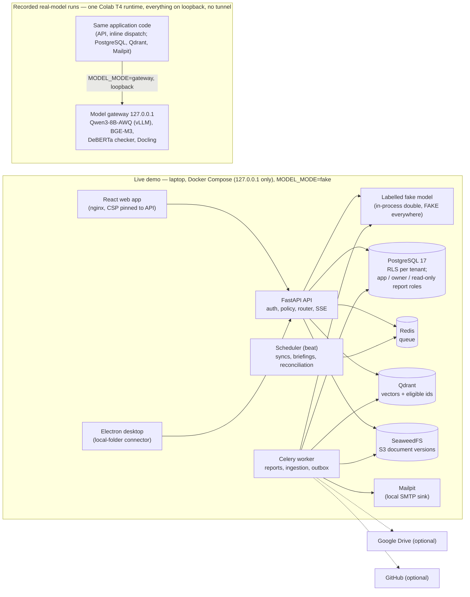

# Architecture overview and evidence index (M8)

## Architecture at a glance

The two boxes are not connected. The live demo never calls a remote gateway: the laptop stack runs with `MODEL_MODE=fake`. Every recorded real-model run ([M2](../evidence/m2/README.md), [M3](../evidence/m3/README.md), [M5 code](../evidence/m5/README.md), [M7 smoke](../evidence/m7-functional/README.md#colab-real-model-smoke-test)) ran the application, its data services, Mailpit and the gateway together inside one Colab runtime, talking over 127.0.0.1. The backend *can* point `LLM_BASE_URL` at a tunnelled gateway (runbook M2 section), but no recorded evidence or demo step uses that.

| Concern | How it works | Decision |
| --- | --- | --- |
| Identity and tenants | Short-lived JWT bound to a server session; PostgreSQL row-level security on every tenant table | [0101](../adr/0101-identity-and-session.md), [0102](../adr/0102-tenant-boundary.md) |
| Authorization | Reference policy: role, department, classification, country, explicit grants and denies; checked again at publication | [0103](../adr/0103-authorization-reference-policy.md) |
| Document answers | Deterministic ingestion into versioned generations. Retrieval is limited to point ids the reader may see at that moment. Every sentence quotes an exact passage, re-checked by hash. Refusals look the same whether a document is forbidden or absent | [0301](../adr/0301-document-ingestion-and-generations.md), [0303](../adr/0303-eligible-id-retrieval.md), [0304](../adr/0304-citations-and-refusals.md) |
| Sales reports | Model drafts SQL → validator → a separate read-only, row-scoped role → figures compared exactly with the stored result → the summary is shown only if verified; events are streamed and the result is published once | [0201](../adr/0201-restricted-report-sql.md)–[0204](../adr/0204-report-verification.md) |
| Contracts | Facts re-derived from cited passages by fixed rules; no model | [0501](../adr/0501-legal-pack.md) |
| Connectors | Drive and GitHub sync with permission freshness; local folders through the desktop app | [0401](../adr/0401-drive-sync-and-freshness.md), [0502](../adr/0502-github-repositories-and-code.md), [0503](../adr/0503-desktop-local-folder.md) |
| Administration | Scoped admin console; per-tenant packs and connectors enforced in the backend | [0402](../adr/0402-scoped-administration.md), [0403](../adr/0403-tenant-configuration.md) |
| Actions | Versioned email draft → human approval of that exact version → durable outbox → Mailpit, with an explicit `uncertain` state and reconciliation by Message-ID; briefings only ever create drafts | [0601](../adr/0601-email-approval-and-outbox.md), [0602](../adr/0602-scheduled-briefings.md) |
| Models | All real models run on a Colab GPU behind the gateway, with pinned revisions the backend checks; the recorded runs reached it over loopback inside the same Colab runtime. `MODEL_MODE=fake` is a deterministic double labelled FAKE in the UI, on every event, and in email bodies; production refuses it | [0105](../adr/0105-runtime-and-compose.md), [model gateway contract](../contracts/model-gateway.md) |

All decisions: [docs/adr/README.md](../adr/README.md). API: [openapi.json](../openapi.json). Traceability: [requirements-traceability.md](../requirements-traceability.md).

## What was tested where

**No workflow was driven in the browser with the real model.** Browser walkthroughs used the labelled fake model on the laptop. Real-model runs used the same application code in a Colab T4 runtime, driven by the API scripts over loopback (no tunnel, within Colab's usage rules). "Browser" below means the web UI was clicked through in a real browser.

| Workflow | Browser, labelled fake model | Real model in Colab (Qwen3-8B-AWQ, BGE-M3, dev-baseline checker) | Other |
| --- | --- | --- | --- |
| Login, tenant, session | **PASS** M7 1a, 26 Nov ([walkthrough](../evidence/m7-functional/2026-11-26-ui-walkthrough-compose-fake-model.json)); M8 rehearsal 27 Nov | Not separately; implied by every Colab run | `smoke_stack.py` 12/12 on 27 Nov |
| Document permissions and citations | **PASS** M7 1b, 1c, 3b, 3c ([walkthrough](../evidence/m7-functional/2026-11-26-ui-walkthrough-compose-fake-model.json), [citation reopen](../evidence/m7-functional/2026-11-26-check1-citation-reopen.json)); M8 rehearsal 27 Nov | **PASS** 21 Nov: authorized answer, opened citation, and the sales reader's refusal in gateway mode ([M3 Colab demo](../evidence/m3/2026-11-21-colab-demo.json), [M3 README](../evidence/m3/README.md)) | Retrieval quality, dense vs hybrid, on BGE-M3 ([retrieval eval](../evidence/m3/2026-11-21-colab-retrieval-eval.md)); parser scores ([Docling](../evidence/m3/2026-11-21-colab-parsers-scores.md)) |
| Verified sales report | **PASS** M7 2 ([M2 capture](../evidence/m7-functional/2026-11-26-m2-capture-compose-fake-model.json)); M8 rehearsal 27 Nov | **PASS** 21 Nov ([M2 real model](../evidence/m2/2026-11-21-colab-real-model.json), [README](../evidence/m2/README.md)) and 26 Nov ([M7 smoke](../evidence/m7-functional/2026-11-26-colab-real-model-smoke/)): 291 orders, net USD 80,934,385.00, checker 0.9929 / 0.9972 / 0.9899 | Frozen case `m1-sales-q1-2026-net-fulfilled` ([worked example](../data/sales-report-q1-2026.md)) |
| Approval → exactly one Mailpit delivery | **PASS** M6 browser check 25 Nov ([JSON](../evidence/m6/2026-11-25-browser-check-compose-fake-model.json)); M7 4a–4c; M8 rehearsal 27 Nov | **PASS** 26 Nov: real-model report → 422 for the unauthorized recipient; 409 for pre-edit, forged and reused approvals; v2 delivered, Mailpit total 1 ([checks](../evidence/m7-functional/2026-11-26-colab-real-model-smoke/checks.json), [demo JSON](../evidence/m7-functional/2026-11-26-colab-real-model-smoke/m6-demo-real-model.json)) | Crash and uncertain-state tests ([M6 evidence](../evidence/m6/README.md)) |
| Scheduled briefings | **PASS** M7 4d ([check4](../evidence/m7-functional/2026-11-26-check4-drafts-and-briefing.json)) | Not run | Live beat run 25 Nov ([JSON](../evidence/m6/2026-11-25-live-briefing-compose-fake-model.json)) |
| Contracts (legal pack) | **PASS** M7 5a; M8 rehearsal 27 Nov | Not applicable: no model is involved | `test_m5_legal*.py` ([M5 evidence](../evidence/m5/README.md)) |
| Code answers (GitHub) | Blocked in M7 (no repository-scoped token) | **PASS** 24 Nov, 22/22, against the GitHub double ([JSON](../evidence/m5/2026-11-24-colab-code-real-model.json)) | Live GitHub with the fake model 22/22, 24 Nov ([JSON](../evidence/m5/2026-11-24-github-acceptance-live-fake-model.json)) |
| Google Drive | Not driven in the browser in M7 | Not run | Live Drive with the fake model, 21 Nov ([JSON](../evidence/m4/2026-11-21-live-drive-direct-share.json)) |
| Desktop (Electron) | Real app against the real backend, fake model: Debian 26 Nov ([JSON](../evidence/m7-functional/2026-11-26-desktop-smoke-compose-fake-model.json)), Windows 24 Nov ([JSON](../evidence/m5/2026-11-24-desktop-smoke-windows-live.json)) | Not run | — |

The M7 acceptance report holds the full checklist and the fixed bugs: [evidence/m7-functional/README.md](../evidence/m7-functional/README.md).

## Model evaluation (context only; not part of this PR)

Model-quality work is outside M8 defense preparation. Existing records: [M7 evaluation foundation](../evaluation/m7-foundation.md), [v3 corpus](../evaluation/m7-v3-corpus.md), [checker baselines](../evaluation/m7-checker-baselines.md), [baseline run](../evaluation/m7-baseline-run.md), [HHEM baseline](../evaluation/m7-hhem-baseline.md). The checker in every demo and Colab run is the **development baseline** (DeBERTa-v3 MNLI, threshold 0.5 uncalibrated), not a trained checker.

## Known limitations to state at the defense

- The live demo uses the labelled fake model. Real-model behaviour is shown only through recorded Colab evidence, because Colab cannot reliably serve a live endpoint.
- The narrative checker is a development baseline with an uncalibrated threshold.
- Live Drive and GitHub need operator credentials and a second account; they are optional and were last run on 21 and 24 Nov.
- The web session lasts 15 minutes and is not refreshed; reloading signs you out (by design).
- Contract answers say "expires on" even for a date in the past (Red Sea, 30 June 2026).
- The Ask button reads "Run report" for every source.
